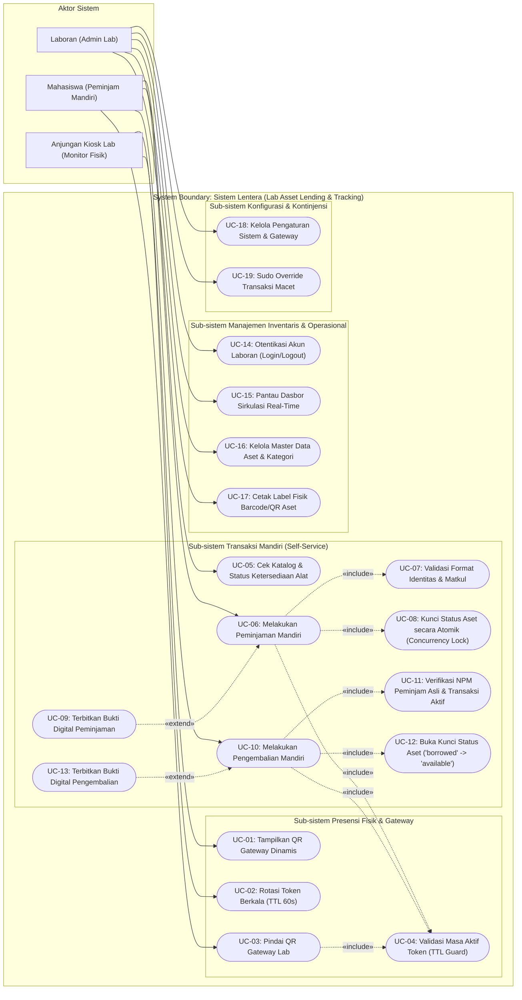

# DOKUMENTASI & SPESIFIKASI USE CASE DIAGRAM SISTEM LENTERA
> **Domain Kerja:** `@audit/diagrams/`  
> **Analis Alur Sistem:** Zahraan Dzakii Ts. (NPM: 24903460011) & Kelompok 1  
> **Mata Kuliah:** Pengujian Perangkat Lunak (KB260004 &middot; 2 SKS)  
> **Program Studi:** Teknologi Rekayasa Multimedia (TRM3A1) &middot; TA 2026/2027  
> **Dosen Pengampu:** Charmiyanti Nurkentjana Aju, S.Kom., M.Kom.  
> **Standar Rujukan:** UML 2.5 (Unified Modeling Language) & ISO/IEC/IEEE 29119 Software Testing Standard

---

## 1. PENDAHULUAN & BATASAN SISTEM (SYSTEM BOUNDARY)

Dokumen ini mendeskripsikan secara komprehensif pemodelan fungsionalitas sistem **Lentera (Laboratory Asset Lending & Tracking System)** melalui **Use Case Diagram**. 

Sistem Lentera dirancang dengan arsitektur anjungan mandiri hibrida (*hybrid self-service kiosk*), yang menghubungkan perangkat fisik laboratorium dengan peramban seluler mahasiswa dan basis data PostgreSQL (Supabase).

Batasan sistem (*System Boundary*) mencakup seluruh proses yang terjadi di dalam ekosistem serverless Next.js dan Supabase, memisahkan interaksi pengguna di dunia nyata dari logika komputasi internal, transaksi atomik, serta penjaminan mutu sirkulasi barang praktikum.

---

## 2. DIAGRAM USE CASE SISTEM LENTERA

Diagram di bawah ini disusun menggunakan sintaks murni **Mermaid** yang dapat dirender langsung pada pratinjau Markdown repositori, portal audit, maupun diintegrasikan ke berkas presentasi perkuliahan:



---

## 3. PROFILING & TAKSONOMI AKTOR (ACTORS)

Sistem Lentera membagi aktor ke dalam tiga kategori berdasarkan peran dan batas fisik interaksinya:

| Nama Aktor | Kategori Aktor | Deskripsi & Peran dalam Sistem | Antarmuka Target |
|---|---|---|---|
| **Mahasiswa** | *Primary Human Actor* | Sivitas akademika yang meminjam dan mengembalikan inventaris peralatan praktikum multimedia. Berinteraksi langsung melalui perangkat seluler (*mobile viewport*). | `/scan`, `/form/borrow`, `/form/return`, `/cek-alat` |
| **Laboran (Admin Lab)** | *Primary Human Actor* | Staf pengelola laboratorium yang memiliki hak istimewa (*privileged rights*) untuk mengelola master data aset, memantau pergerakan barang, mencetak label, dan menangani insiden transaksi. | `/login`, `/admin/dashboard`, `/admin/print-labels`, `/admin/settings` |
| **Anjungan Kiosk Lab** | *Secondary / Device Actor* | Perangkat monitor stasioner berbasis anjungan mandiri di ruang lab fisik. Berfungsi sebagai penjamin bukti kehadiran fisik peminjam melalui rotasi QR Code berkala. | `/display` (Kiosk Screen Fullscreen) |

---

## 4. DEKOMPOSISI PAKET FUNGSIONAL (USE CASE CLUSTERS)

### Paket 1: Presensi Fisik & Sesi Gateway
Paket ini menangani pencegahan kecurangan peminjaman jarak jauh (*remote borrowing fraud*).
* **UC-01 (Tampilkan QR Gateway Dinamis):** Kiosk menampilkan kode matriks dua dimensi yang memuat tautan ber-token kriptografis unik.
* **UC-02 (Rotasi Token Berkala TTL 60 Detik):** Kiosk secara otomatis meminta pasangan token baru ke server setiap 60 detik agar tautan lama hangus.
* **UC-03 (Pindai QR Gateway Lab):** Mahasiswa memindai QR Code menggunakan kamera smartphone untuk masuk ke gerbang transaksi lab.
* **UC-04 (Validasi Masa Aktif Token - TTL Guard):** Sistem mengevaluasi apakah token yang dibawa mahasiswa masih dalam rentang masa hidup aktif (*valid time window*). Jika kedaluwarsa, akses langsung diblokir.

### Paket 2: Transaksi Mandiri Mahasiswa (Self-Service)
Paket operasional harian mahasiswa saat meminjam dan mengembalikan alat:
* **UC-05 (Cek Katalog & Status Ketersediaan Alat):** Mahasiswa melihat inventaris alat laboratorium beserta status terkini (`available`, `borrowed`, `maintenance`).
* **UC-06 (Melakukan Peminjaman Mandiri):** Mahasiswa mengajukan peminjaman dengan mengisi identitas dan memilih alat yang tersedia.
* **UC-07 (Validasi Format Identitas & Matkul):** Sistem memvalidasi struktur input (NPM 11 digit numerik, nama lengkap, program studi, mata kuliah, dosen penanggung jawab).
* **UC-08 (Kunci Status Aset secara Atomik):** Sistem mengunci record baris barang di basis data secara atomik agar tidak terjadi *race condition* jika dua mahasiswa mengklik barang yang sama pada detik bersamaan. Status diubah menjadi `borrowed`.
* **UC-09 (Terbitkan Bukti Digital Peminjaman):** Sistem menerbitkan tanda terima digital berisi detail transaksi dan timestamp sukses.
* **UC-10 (Melakukan Pengembalian Mandiri):** Mahasiswa mengembalikan alat fisik ke lab dan menuntaskan transaksi pada sistem.
* **UC-11 (Verifikasi NPM Peminjam Asli & Transaksi Aktif):** Sistem mencocokkan apakah barang tersebut benar sedang dipinjam oleh NPM bersangkutan untuk mencegah manipulasi penutupan pinjaman oleh orang lain.
* **UC-12 (Buka Kunci Status Aset):** Sistem memperbarui status aset kembali menjadi `available` dan mencatat `returned_at`.
* **UC-13 (Terbitkan Bukti Digital Pengembalian):** Sistem menampilkan notifikasi resmi bahwa transaksi telah ditutup dengan aman.

### Paket 3: Manajemen Inventaris & Operasional Laboran
Paket antarmuka administratif pengawasan dan pemeliharaan:
* **UC-14 (Otentikasi Akun Laboran):** Verifikasi identitas laboran melalui email dan kata sandi terenkripsi (dengan manajemen session/cookie aman).
* **UC-15 (Pantau Dasbor Sirkulasi Real-Time):** Visualisasi statistik jumlah barang keluar, barang tersedia, riwayat peminjam aktif, dan peringatan keterlambatan.
* **UC-16 (Kelola Master Data Aset & Kategori):** Operasi CRUD (Create, Read, Update, Delete) untuk peralatan lab baru, pengelompokan kategori (Audio, Video, Lighting, Komputasi), dan perbaikan status barang rusak (`maintenance`).
* **UC-17 (Cetak Label Fisik Barcode/QR Aset):** Fasilitas generate dan print sheet stiker barcode/QR fisik untuk ditempelkan pada fisik kamera, lensa, mikrofon, atau tripod.

### Paket 4: Konfigurasi Sistem & Kontinjensi
* **UC-18 (Kelola Pengaturan Sistem & Gateway):** Menentukan masa berlaku token kuis (TTL), jam buka-tutup lab, dan parameter kuota peminjaman.
* **UC-19 (Sudo Override Transaksi Macet):** Fitur bypass darurat oleh laboran untuk membuka kunci barang atau membatalkan transaksi bermasalah jika mahasiswa lupa mengembalikan atau sistem mengalami anomali jaringan.

---

## 5. ANALISIS SEMANTIK RELASI UML: `<<include>>` VS `<<extend>>`

Dalam standar UML 2.5, pembedaan antara relasi `<<include>>` dan `<<extend>>` mencerminkan arsitektur integritas perangkat lunak:

```text
+--------------------------------------------------------------------------+
|  <<include>> : Relasi Ketergantungan Wajib (Mandatory Dependency)         |
|  Use case dasar TIDAK DAPAT dianggap selesai atau sah tanpa eksekusi      |
|  use case yang di-include. Kegagalan use case include membatalkan induk.  |
+--------------------------------------------------------------------------+

+--------------------------------------------------------------------------+
|  <<extend>>  : Relasi Perluasan Kondisional (Optional / Conditional)      |
|  Use case ekstensi hanya dieksekusi jika kondisi tertentu (extension     |
|  point) terpenuhi, tanpa mengubah alur dasar use case yang diperluas.    |
+--------------------------------------------------------------------------+
```

### Penerapan pada Kasus Lentera:

1. **Mengapa UC-04 (`Validasi Masa Aktif Token`) di-include oleh UC-03, UC-06, dan UC-10?**
   * *Alasan Teknis:* Di sistem perbankan atau anjungan lab berisiko tinggi, transaksi tidak boleh diproses jika token kedaluwarsa. Sistem tidak memberikan opsi alternatif; tanpa token valid, transaksi **gugur secara mutlak** (HTTP 401 / 403).

2. **Mengapa UC-08 (`Kunci Status Aset secara Atomik`) di-include oleh UC-06 (`Peminjaman Mandiri`)?**
   * *Alasan Teknis:* Dalam pengujian konkurensi (*race condition*), penguncian record (*row-level locking* atau atomic state mutation) adalah bagian integral tak terpisahkan dari eksekusi peminjaman. Jika penguncian gagal (karena barang telah diambil dalam milidetik yang sama), peminjaman tidak boleh berlanjut.

3. **Mengapa UC-09 dan UC-13 bertindak sebagai `<<extend>>`?**
   * *Alasan Teknis:* Penerbitan bukti digital peminjaman dan pengembalian merupakan cabang hasil yang hanya terjadi pada *extension point* keberhasilan transaksi (`onSuccess`). Jika transaksi mengalami konflik HTTP 409 (*asset already borrowed*), use case dasar selesai dalam status *rejected* tanpa pernah memanggil use case bukti digital ini.

---

## 6. SPESIFIKASI DETAIL USE CASE INTI (HIGH-PRIORITY UC SPECIFICATIONS)

### Spesifikasi 1: UC-06 (Melakukan Peminjaman Mandiri)

| Atribut Spesifikasi | Uraian Lengkap |
|---|---|
| **Use Case ID** | **UC-06** |
| **Nama Use Case** | Melakukan Peminjaman Mandiri Alat Laboratorium |
| **Aktor Utama** | Mahasiswa |
| **Aktor Sekunder** | Anjungan Kiosk Lab (Penyedia Sesi), Basis Data Supabase |
| **Deskripsi Singkat** | Mahasiswa mengisi formulir peminjaman alat setelah memvalidasi token gateway anjungan lab dan memilih alat yang berstatus `available`. |
| **Pre-kondisi** | 1. Mahasiswa telah memindai QR Kiosk fisik dan membawa token gateway aktif.<br>2. Peralatan yang diinginkan berstatus `available` di basis data. |
| **Post-kondisi** | 1. Status peralatan berubah menjadi `borrowed`.<br>2. Record transaksi baru tercatat pada tabel `transactions`.<br>3. Layar display kiosk merefleksikan pengurangan stok alat secara real-time. |
| **Alur Utama (Main Flow)** | 1. Mahasiswa mengakses halaman formulir peminjaman (`/form/borrow?token=...`).<br>2. Sistem memvalidasi masa aktif token gateway (`<<include>> UC-04`).<br>3. Mahasiswa mengisi NPM, Nama, Program Studi, Mata Kuliah, Dosen Pengampu, dan memilih ID Barang.<br>4. Mahasiswa menekan tombol "Kirim Peminjaman".<br>5. Sistem memvalidasi kesesuaian format data input (`<<include>> UC-07`).<br>6. Sistem mengeksekusi penguncian atomik dan mutasi status barang (`<<include>> UC-08`).<br>7. Sistem menerbitkan tanda terima digital peminjaman (`<<extend>> UC-09`). |
| **Alur Alternatif (Alternative Flow)** | **A1: Token Gateway Kedaluwarsa**<br>&bull; Jika selisih waktu scan > 60 detik, sistem menolak request, menampilkan pesan *"Token sesi lab kedaluwarsa, silakan scan ulang di monitor anjungan"*, dan menghentikan proses.<br>**A2: Konflik Konkurensi / Barang Telah Terpinjam**<br>&bull; Jika barang yang dipilih diubah statusnya oleh transaksi lain sesaat sebelum submit, sistem mengembalikan kode HTTP 409 Conflict, memunculkan modal peringatan, dan menyegarkan daftar pilihan alat. |

---

### Spesifikasi 2: UC-10 (Melakukan Pengembalian Mandiri)

| Atribut Spesifikasi | Uraian Lengkap |
|---|---|
| **Use Case ID** | **UC-10** |
| **Nama Use Case** | Melakukan Pengembalian Mandiri Alat Laboratorium |
| **Aktor Utama** | Mahasiswa |
| **Aktor Sekunder** | Basis Data Supabase |
| **Deskripsi Singkat** | Mahasiswa mengembalikan peralatan ke ruang lab dan menutup status pinjaman menggunakan verifikasi identitas peminjam awal. |
| **Pre-kondisi** | 1. Aset berstatus `borrowed` dalam transaksi aktif yang belum memiliki nilai `returned_at`.<br>2. Mahasiswa memindai QR Gateway aktif di dalam laboratorium. |
| **Post-kondisi** | 1. Status aset di tabel `assets` kembali menjadi `available`.<br>2. Kolom `returned_at` pada record `transactions` terisi timestamp terkini. |
| **Alur Utama (Main Flow)** | 1. Mahasiswa mengakses menu pengembalian (`/form/return?token=...`).<br>2. Sistem memvalidasi token gateway anjungan lab (`<<include>> UC-04`).<br>3. Mahasiswa memasukkan nomor identitas (NPM) atau memindai kode barang.<br>4. Sistem mencari transaksi aktif yang berelasi dan mencocokkan identitas peminjam (`<<include>> UC-11`).<br>5. Mahasiswa mengonfirmasi pengembalian fisik barang.<br>6. Sistem memperbarui status aset kembali menjadi `available` (`<<include>> UC-12`).<br>7. Sistem menerbitkan bukti digital pengembalian sukses (`<<extend>> UC-13`). |
| **Alur Alternatif (Alternative Flow)** | **B1: NPM Tidak Sesuai dengan Peminjam Awal**<br>&bull; Sistem menolak eksekusi jika NPM yang diinputkan tidak cocok dengan peminjam yang tercatat di tabel `transactions` untuk barang tersebut, guna mencegah sabotase transaksi.<br>**B2: Barang Tidak Terdaftar Sedang Dipinjam**<br>&bull; Sistem menampilkan pesan kesalahan *"Alat berstatus tersedia, tidak ada transaksi aktif yang perlu dikembalikan"*. |

---

### Spesifikasi 3: UC-16 (Mengelola Master Data Aset & Kategori)

| Atribut Spesifikasi | Uraian Lengkap |
|---|---|
| **Use Case ID** | **UC-16** |
| **Nama Use Case** | Mengelola Master Data Aset & Kategori Laboratorium |
| **Aktor Utama** | Laboran (Admin Lab) |
| **Deskripsi Singkat** | Laboran melakukan pendaftaran barang baru, peremajaan data spesifikasi alat, pengubahan kategori, serta penandaan alat rusak/maintenance. |
| **Pre-kondisi** | Laboran telah melewati otentikasi akun admin (`<<include>> UC-14`). |
| **Post-kondisi** | Master data aset di tabel `assets` dan `categories` terbarui secara presisten. |
| **Alur Utama (Main Flow)** | 1. Laboran membuka halaman manajemen aset di dashboard admin.<br>2. Laboran memilih aksi: Tambah Alat, Ubah Data, Ganti Status Maintenance, atau Hapus.<br>3. Sistem memvalidasi kelengkapan form (Kode Aset unik, Nama Alat, Kategori referensi).<br>4. Sistem menyimpan perubahan ke database Supabase.<br>5. Perubahan data langsung terpropagasi ke katalog publik mahasiswa dan layar kiosk display. |
| **Alur Alternatif (Alternative Flow)** | **C1: Duplikasi Kode Aset**<br>&bull; Jika laboran menginputkan kode aset yang sudah terdaftar (pelanggaran *UNIQUE constraint*), sistem menolak dan menampilkan pesan peringatan error 400 Bad Request. |

---

## 7. MAPPING TRACEABILITY KE STRATEGI PENGUJIAN PERANGKAT LUNAK (QA ALIGNMENT)

Berdasarkan pembagian kerja Kelompok 1 pada mata kuliah Pengujian Perangkat Lunak, Use Case Diagram ini menjadi jangkar pelacakan (*Requirements Traceability Matrix* / RTM) bagi masing-masing anggota penguji:

```text
+----------------------------------------------------------------------------------------------------+
|                                    TRACEABILITY MATRIX LENTERA                                     |
+--------------------------+-----------------------+-------------------------------------------------+
| Wilayah Pengujian        | Penanggung Jawab      | Use Case Sasaran Uji                            |
+--------------------------+-----------------------+-------------------------------------------------+
| White-Box & Logika Path  | Zahraan Dzakii Ts.    | UC-04 (Evaluasi percabangan logika if-else TTL) |
| (@audit/specs/)          | (Senior Analyst)      | UC-07 (Cyclomatic Complexity fungsi validasi)   |
|                          |                       | UC-11 (Basis Path pencocokan identitas DB)      |
+--------------------------+-----------------------+-------------------------------------------------+
| Black-Box & Fungsional   | Syifa Amelia          | UC-05 (Equivalence Partitioning status barang)  |
| (@reports/ & GitHub)     | (Lead Functional QA)  | UC-06 (Boundary Value Analysis NPM 11 digit)    |
|                          |                       | UC-10 (Uji kegagalan pengembalian lintas NPM)   |
|                          |                       | UC-17 (Uji visual pencetakan label barcode)     |
+--------------------------+-----------------------+-------------------------------------------------+
| Integrasi & Konkurensi   | Mu'adz Hudzaifah      | UC-02 (Cron token rotation TTL benchmark)       |
| (@tests/)                | (Lead Test Architect) | UC-08 (Simulasi race condition 50 request/detik)|
|                          |                       | UC-14 (Uji penetrasi endpoint /api/admin/sudo)  |
|                          |                       | UC-19 (Audit trail & atomicity bypass security) |
+--------------------------+-----------------------+-------------------------------------------------+
```

---

## 8. KESIMPULAN

Use Case Diagram sistem Lentera ini berhasil memetakan 19 kasus penggunaan fungsional yang terisolasi dalam 4 subsistem terpadu. Model ini menjamin bahwa seluruh persyaratan bisnis ISO/IEC/IEEE 29119 mengenai integritas data, validasi presensi fisik, dan penguncian aset konkurensi memiliki representasi yang jelas dan dapat diaudit secara komprehensif pada laporan perkuliahan Pertemuan 04.
